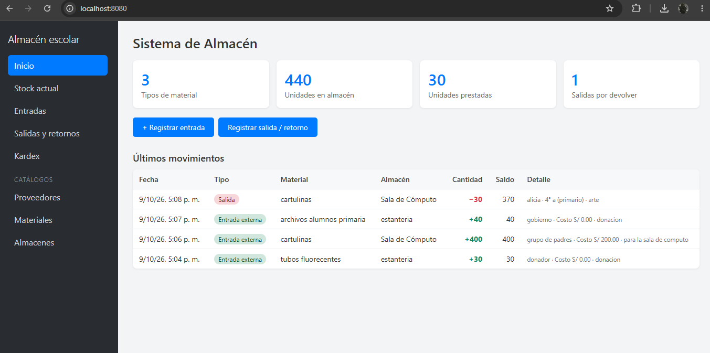
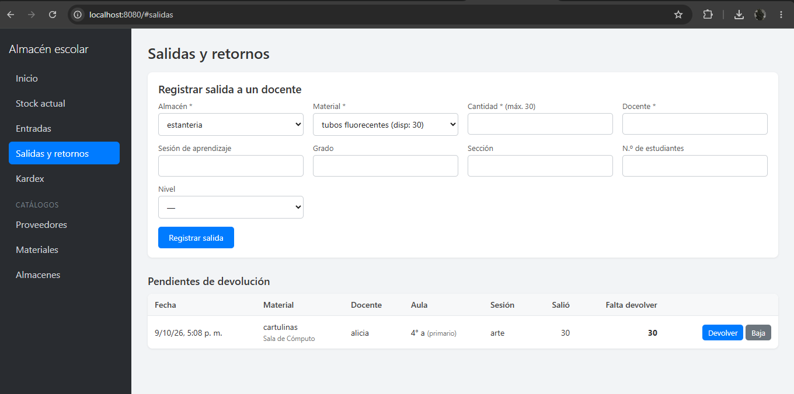

# Sistema de Almacén Escolar

Sistema web para controlar el almacén de un colegio: lo que **llega desde fuera** (gobierno, donaciones, compras), lo que **hay en stock**, y lo que **sale a los docentes y regresa**. Todo queda registrado en un historial (Kardex) que nunca se borra.

Hecho con **PHP + MySQL** (servidor) y **React** (interfaz). Es una sola página: se navega entre pantallas sin recargar.

> 📦 **Instalación:** abre `INSTALAR.html` (paso a paso con XAMPP o con Docker). Para comprobar que quedó bien: `/verificar.php`.

---

## ¿Qué puede hacer?

| Pantalla | Para qué sirve |
|---|---|
| **Inicio** | Resumen: tipos de material, unidades en almacén, unidades prestadas, salidas por devolver y los últimos 8 movimientos. |
| **Stock actual** | Cuánto hay de cada material en cada almacén, cuánto está prestado y el total del colegio. Permite buscar y filtrar. Desde aquí se hace un **Ajuste** por conteo físico. |
| **Entradas** | Registrar lo que llega al colegio desde fuera (proveedor, cantidad, costo, fecha). Suma al stock. |
| **Salidas y retornos** | Entregar material a un docente, y registrar su **devolución** (total o parcial) o una **baja** (si no vuelve). |
| **Kardex** | Historial completo de movimientos, con filtros por almacén, material y tipo. Muestra el **saldo** del almacén después de cada movimiento. |
| **Proveedores** | Catálogo de quién entrega material (ej. UGEL, Ministerio, una empresa). |
| **Materiales** | Catálogo de lo que existe (nombre, unidad: unidad, caja, par…). |
| **Almacenes** | Dónde se guarda el material (ej. Sala de Cómputo). Puede haber varios. |

### Los tipos de movimiento

| Tipo | ¿Qué pasa con el stock del almacén? | ¿Cuándo se usa? |
|---|---|---|
| **Entrada externa** | ➕ Suma | Llegó material de gobierno, donación o compra. |
| **Salida** | ➖ Resta (queda *pendiente de devolver*) | Un docente se lleva material para una clase. |
| **Retorno** | ➕ Suma | El docente devuelve (todo o una parte). |
| **Baja** | ⏸ No cambia | Lo que salió y **no volverá**: consumido, perdido o malogrado. Cierra la deuda del docente. |
| **Ajuste** | ➕/➖ Corrige | El conteo físico no coincide con el sistema. |

Cómo leer el Stock: **En almacén** es lo que está físicamente ahí ahora; **Prestado** es lo que está en manos de docentes; **Total del colegio** es la suma de ambos.

---

## Cómo se usa

### Primera vez (configuración inicial)
1. **Proveedores** → crea quién te entrega material (ej. "UGEL").
2. **Materiales** → crea cada tipo de material (ej. "Laptop XO", unidad "unidad").
3. **Almacenes** → ya viene creado "Sala de Cómputo". Agrega más si los necesitas.

### Cuando llega material al colegio
**Entradas** → elige almacén, material y proveedor, escribe la cantidad (y el costo si lo sabes) → *Registrar entrada*. El stock sube.

### Cuando un docente pide material
**Salidas y retornos** → elige almacén y material (solo aparecen los que tienen stock, con lo disponible entre paréntesis) → escribe cantidad, docente y, si quieres, sesión, grado, sección, nivel y N.º de estudiantes → *Registrar salida*.
El sistema **no te deja sacar más de lo que hay**.

### Cuando el docente devuelve
En la tabla **Pendientes de devolución** pulsa **Devolver**. La cantidad viene llena con lo pendiente; si devuelve solo una parte, escribe esa parte. Lo que falte seguirá en la lista.

### Cuando algo no vuelve (se rompió, se gastó, se perdió)
En esa misma tabla pulsa **Baja** y escribe el motivo. Queda registrado y deja de aparecer como pendiente.

### Cuando el conteo físico no coincide
**Stock actual** → **Ajustar** en esa fila → escribe lo que realmente contaste y el motivo. El sistema calcula la diferencia y la deja en el Kardex.

### Ejemplo de un día
1. Llegan **30 laptops** de la UGEL → *Entradas* → stock: 30.
2. La profesora Ruiz se lleva **10** para 3.º A → *Salidas* → stock: 20, prestado: 10.
3. Devuelve **8** → *Devolver* → stock: 28, pendiente: 2.
4. Una laptop se malogró → *Baja* con motivo "pantalla rota" → pendiente: 1.
5. El Kardex muestra los cuatro movimientos con su saldo.

### Si me equivoqué
Los movimientos **no se editan ni se borran**, para que el historial sea confiable. Se corrigen con un **Ajuste** (si el stock quedó mal) o una **Baja** (si algo no volverá). Los catálogos (proveedores, materiales, almacenes) sí se pueden editar; un registro que ya tiene stock o movimientos no se puede eliminar.

---

## Reglas que el sistema hace cumplir
- No se puede sacar más de lo que hay en el almacén.
- No se puede devolver más de lo que está pendiente.
- Una baja y un ajuste exigen un **motivo**.
- Las cantidades son números enteros mayores que 0.
- Si dos personas operan a la vez, el stock no se descuadra (las operaciones son transaccionales).
- Todas las fechas usan la hora de Perú (`America/Lima`).

## Lo que **todavía no** hace
- **No tiene login**: úsalo solo en la red del colegio, o agrégale inicio de sesión antes de publicarlo.
- No hay traslados entre almacenes (por ahora se hace con un Ajuste en cada almacén).
- No exporta a Excel o PDF.
- No avisa cuando un material tiene poco stock.
- No hay reportes por docente o por período (el Kardex se puede filtrar por almacén, material y tipo).

---

## Para quien lo va a modificar

```
index.html        Única página (carga React)
api.php           Toda la lógica del servidor
config.php        Conexión a MySQL (lee variables de entorno si existen)
database.sql      Tablas
verificar.php     Diagnóstico de instalación
assets/app.js     React compilado (listo para usar)
src/              Código fuente de React (.jsx): npm install && npm run build
Dockerfile, docker-compose.yml, .env    Para correrlo con Docker
```

**Base de datos:** `proveedores`, `materiales`, `almacenes`, `stock` (cuánto hay ahora en cada almacén) y `movimientos` (el Kardex; cada fila guarda el saldo resultante).

**API:** una sola entrada, `api.php?r=<recurso>&a=<acción>`, con cuerpo JSON por POST.
- Catálogos (`proveedores`, `materiales`, `almacenes`): `listar`, `guardar`, `eliminar`.
- `inventario`: `stock`, `salidas_activas`, `kardex`, `entrada`, `salida`, `retorno`, `baja`, `ajuste`.
- Los errores vuelven como `{"error": "mensaje"}` y la interfaz los muestra en un aviso rojo.

**Para agregar un catálogo nuevo** basta con una entrada en `TABLAS` (`api.php`), su tabla en `database.sql` y una configuración de columnas en `src/App.jsx`; la pantalla de CRUD ya es genérica.


# 📦 Instalación del Sistema de Almacén

Elige una de las siguientes opciones para poner en marcha el sistema:

- **Opción A:** Instalación en Windows usando **XAMPP** *(7 pasos, ~10 minutos)*.
- **Opción B:** Instalación rápida con **Docker** *(Recomendada para llevar el sistema a otro equipo sin repetir pasos)*.

  
  

---

## 🛠️ Opción A: Instalación con XAMPP (Windows)

### 1. Instala y enciende XAMPP
* Si no lo tienes, descárgalo de [apachefriends.org](https://www.apachefriends.org/) e instálalo (todo con *"Siguiente"*).
* Abre el **XAMPP Control Panel** y pulsa **Start** en **Apache** y en **MySQL**. Deben ponerse en verde.

### 2. Copia la carpeta del sistema
* Descomprime el `.zip`. Verás una carpeta llamada `almacen-colegio`.
* Cópiala dentro de `C:\xampp\htdocs\`. Debe quedar `C:\xampp\htdocs\almacen-colegio\index.html`.

### 3. Abre phpMyAdmin
* En el navegador entra a [http://localhost/phpmyadmin](http://localhost/phpmyadmin) (o pulsa **Admin** en la fila de MySQL de XAMPP).

### 4. Crea la base de datos (vacía)
* En el menú de la izquierda pulsa **Nueva**.
* En *Nombre de la base de datos* escribe exactamente: `almacen_colegio`
* Al lado, en el desplegable, elige `utf8mb4_unicode_ci`.
* Pulsa **Crear**.

### 5. Importa las tablas
* Haz clic en `almacen_colegio` en el menú izquierdo (que quede seleccionada).
* Arriba, entra a la pestaña **Importar**.
* Pulsa **Seleccionar archivo** y elige `database.sql` (está dentro de la carpeta del sistema).
* Baja hasta el final y pulsa **Importar** (o *"Continuar"*).

> **Verificación:** Si sale un recuadro verde con *"La importación se ha completado"*, ya está. A la izquierda verás 5 tablas dentro de `almacen_colegio`.

### 6. Comprueba que todo esté bien
* Abre [http://localhost/almacen-colegio/verificar.php](http://localhost/almacen-colegio/verificar.php)
* Debes ver todo con ✅. Si aparece algún ❌, ahí mismo te dice qué hacer.

### 7. ¡Usa el sistema!
* Entra a [http://localhost/almacen-colegio/](http://localhost/almacen-colegio/)
* **Primer uso, en este orden:**  
  `Proveedores` (por ejemplo *"Gobierno / UGEL"*) ➔ `Materiales` ➔ `Entradas` (registrar lo que llegó).  
  *Después ya puedes hacer Salidas y retornos.*

---

## 🐳 Opción B: Instalar con Docker

Sirve si prefieres no instalar XAMPP, o si quieres llevar el sistema a otro computador o servidor sin repetir pasos. Crea solo la base de datos y las tablas.

### 1. Instala Docker Desktop
* Descárgalo de [docker.com](https://www.docker.com/), instálalo y ábrelo. Espera a que diga *"Engine running"*.

### 2. Cambia la clave de MySQL
* Abre el archivo `.env` (en la carpeta del sistema) con el Bloc de notas y cambia `cambia-esta-clave` por una clave tuya.

> ⚠️ **Importante:** Hazlo antes del paso 3. MySQL guarda la clave la primera vez que arranca; si la cambias después, hay que borrar los datos y empezar de cero.

### 3. Enciende el sistema
* Abre una terminal (PowerShell) dentro de la carpeta del sistema.  
  *(Truco: en el Explorador de archivos, escribe `powershell` en la barra de direcciones y presiona Enter).*
* Ejecuta:
  ```bash
  docker compose up -d --build
  ```
*(La primera vez tarda unos minutos porque descarga PHP y MySQL).*

### 4. Entra al sistema
* Sistema: [http://localhost:8080/](http://localhost:8080/)
* Comprobar instalación: [http://localhost:8080/verificar.php](http://localhost:8080/verificar.php)
*(Las tablas ya están creadas, no hay que importar nada).*

---

### ⚙️ Comandos útiles de Docker

| Acción | Comando |
| :--- | :--- |
| **Apagar** *(los datos se conservan)* | `docker compose down` |
| **Volver a encender** | `docker compose up -d` |
| **Ver errores de web** | `docker compose logs web` |
| **Ver errores de la BD** | `docker compose logs db` |
| **Respaldo** *(hazlo seguido)* | `docker compose exec db sh -c "mysqldump -uroot -p$MYSQL_ROOT_PASSWORD almacen_colegio" > respaldo.sql` |
| **Si cambias archivos del sistema** | `docker compose up -d --build` |
| ⚠️ **Borrar todo y empezar de cero** | `docker compose down -v` *(¡esto borra los datos!)* |

> 💡 **Si el puerto 8080 está ocupado:**  
> En `docker-compose.yml` cambia `"8080:80"` por otro puerto, por ejemplo `"8081:80"`, y entra por `http://localhost:8081/`.

---

## ❓ Si algo falla

* **"Connection refused" / no abre la página:**  
  Apache no está encendido. Pulsa **Start** en Apache en el panel de XAMPP.

* **En `verificar.php` sale "MySQL está apagado":**  
  Pulsa **Start** en la fila de MySQL en el panel de XAMPP.

* **Sale "Usuario o contraseña incorrectos":**  
  Si le pusiste clave a MySQL, abre `config.php` con el Bloc de notas y escríbela en `DB_PASS`.

* **Sale "La base almacen_colegio no existe":**  
  Repite el paso 4. El nombre debe ser exactamente `almacen_colegio`, sin espacios ni mayúsculas.

* **Al importar sale un error rojo:**  
  Casi siempre es porque no seleccionaste la base antes de importar (paso 5, primer punto), o porque ya habías importado antes. Borra la base (pestaña *Operaciones* ➔ *"Eliminar la base de datos"*), créala de nuevo y vuelve a importar.

---

## 🌐 Quiero usarlo desde otro computador de la red del colegio

Deja el sistema instalado en un solo computador (el "servidor") y, desde los demás, abre `http://IP-DEL-SERVIDOR/almacen-colegio/`. La IP la ves en ese computador con el comando `ipconfig`. 

> 📌 **Importante:** El sistema no tiene clave de acceso, úsalo solo dentro de la red del colegio.

---

## 🛠️ No uso XAMPP (Laragon, hosting, etc.)

Es igual: crea una base de datos MySQL, importa `database.sql` en ella, y pon el nombre de la base, el usuario y la clave en `config.php`. Necesita **PHP 7.4 o superior**.
